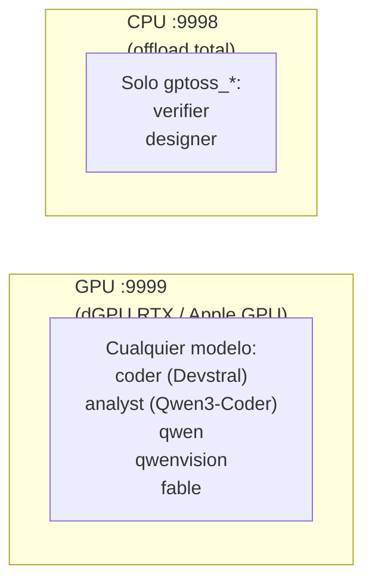

# ropero — lanzador de modelos locales

> Gestor simplificado de modelos de lenguaje. Añadir un modelo = añadir un
> archivo `.sh`. Ropera (de ahí el nombre) todos los motores bajo una misma CLI.

---

## ¿Qué es ropero?

**El problema**: tener 14 modelos con configuraciones distintas (llama-server,
MLX, AirLLM, TensorRT), cada uno con sus flags, sus GGUFs, sus contextos,
es un infierno.

**La solución**: un directorio de scripts (`ropero.d/`), cada uno describiendo
un modelo. `ropero` los descubre, los indexa y los lanza con la CLI correcta.

**Filosofía**: añadir un modelo = añadir un `.sh`. Nada más.

---

## Instalación

```bash
./ropero --install
./ropero --check
```

`--install`:

1. Instala dependencias (pacman/brew según OS).
2. Clona y compila `llama.cpp` (20-40 min la primera vez, con CUDA/Metal).
3. Instala `airllm` / `mlx-lm` / `tensorrt-llm` (best-effort, pregunta).
4. Descarga los GGUF por defecto (~50 GB).
5. Crea symlinks en `~/.local/bin/ropero` + `ropero.d/`.

`--check` verifica:

- Symlinks en `~/.local/bin/`.
- Modelos GGUF descargados.
- `llama-server` compilado y en PATH.
- `BIN_DIR` en PATH.

---

## Uso

### Listar modelos

```bash
ropero list
```

Salida:

```
Modelos disponibles:
  devstral     ctx=131072  gguf=Devstral-Small-2-24B-Instruct-2512-UD-Q4_K_XL.gguf  engine=llama-server
  coder        ctx=131072  gguf=Devstral-Small-2-24B-Instruct-2512-UD-Q4_K_XL.gguf  engine=llama-server
  analyst      ctx=131072  gguf=Qwen3-Coder-30B-A3B-Instruct-UD-Q4_K_XL.gguf  engine=llama-server
  ...
```

**Ojo**: cada modelo puede tener **dos nombres**:

- El nombre del script (`devstral`) → modelo físico.
- El alias público (`coder`) → nombre que usan los agentes de `gunter`.

Ambos apuntan al mismo proceso.

### Arrancar un modelo

```bash
# Primer plano (logs en pantalla, coloreados)
ropero analyst

# Background (logs a ~/.logs/ropero/)
ropero analyst --background

# En CPU (slot :9998, sin GPU)
ropero verifier --cpu --background

# Forzar si el slot destino está ocupado por otro
ropero coder --force --background
```

### Estado

```bash
ropero status              # resumen de ambos slots
ropero status --craft      # render artesanal (sin alaja)
ropero status --watch      # refresco continuo cada 1s
ropero status --watch 500  # refresco cada 500ms
```

Muestra:

- CPU/GPU GHz, RAM/VRAM, temp, fan RPM.
- Slots activos (`:9999` GPU, `:9998` CPU).
- Modelo, PID, uptime, engine.

### Parar

```bash
ropero stop analyst   # un modelo concreto
ropero stop all       # ambos slots
```

---

## Arquitectura — dual-slot



**Reglas**:

- GPU y CPU pueden coexistir con modelos distintos.
- `gptoss_*` es el único que va bien en CPU. Los demás van a GPU.
- `--cpu` arranca en `:9998` con todos los layers en CPU.
- `--force` mata el slot destino si está ocupado por otro modelo (no toca el otro slot).

---

## Estructura del repo

```
ropero/
├── ropero                     entry point (bash, dispatch)
├── ropero.d/                  módulos
│   ├── _common.sh             helpers comunes
│   ├── _gptoss_common.sh      helper específico de gptoss
│   ├── 00-utils.sh            helpers de logging / prompts
│   ├── 01-env.sh              defaults de entorno (BIN_DIR, GGUF_DIR...)
│   ├── 20-compile-llama.sh    compilación de llama.cpp (CMake flags)
│   ├── 21-download-models.sh  descarga de los GGUF por defecto
│   ├── devstral.sh            modelo: Devstral (alias "coder")
│   ├── qwencoder.sh           modelo: Qwen3-Coder-30B (alias "analyst")
│   ├── qwen.sh                modelo: Qwen3.8-27B (alias "analyst" alt)
│   ├── gptoss_high.sh         modelo: gpt-oss reasoning high (alias "verifier")
│   ├── gptoss_medium.sh       modelo: gpt-oss reasoning medium (alias "designer")
│   ├── gptoss_low.sh          modelo: gpt-oss reasoning low
│   ├── embed.sh               modelo: embeddings (jina-code)
│   ├── qwenvision.sh          modelo: Qwen2.5-VL (visión)
│   ├── fable.sh               modelo: Fable Coder 35B
│   └── fired/                 modelos fuera del scope actual (archivados)
├── README.md                  este archivo
├── CHANGELOG.md
└── docs/
    └── model-eval.md          benchmarking de modelos
```

---

## Añadir un modelo nuevo

### 1. Crear el script

```bash
cat > ropero.d/mi-modelo.sh <<'EOF'
#!/usr/bin/env bash
# mi-modelo.sh — Descripción del modelo

MODEL_ENGINE="llama-server"
MODEL_GGUF="mi-modelo-Q4_K_M.gguf"
MODEL_CTX="${ROPERO_MI_MODELO_CTX:-131072}"

# Alias público opcional (ropero lo registra como nombre alternativo)
MODEL_ALIAS="${MODEL_ALIAS:-mi-alias}"

get_model_args_mi_modelo() {
    local -a args=(
        --n-gpu-layers 999
        --no-kv-offload
        --cache-type-k q8_0
        --cache-type-v q8_0
        --jinja
        --temp 0.6
        --top-p 0.95
        --n-predict 4096
    )
    printf '%s\n' "${args[@]}"
}
EOF
```

### 2. (Opcional) Añadir descarga automática

En `ropero.d/21-download-models.sh`, añadir una línea:

```bash
ropero_download_gguf "repositorio/org/mi-modelo-GGUF" \
    "mi-modelo-Q4_K_M.gguf" "Mi Modelo Q4" "10 GB"
```

### 3. Probar

```bash
ropero list | grep mi-modelo
ropero mi-modelo --background
```

---

## Overrides por env

Cada modelo admite variables para no editar el `.sh`:

```bash
# Cambiar contexto
ROPERO_ANALYST_CTX=65536 ropero analyst

# Cambiar n-cpu-moe (offload a CPU)
ROPERO_CODER_N_CPU_MOE=40 ropero coder

# Ver todas las variables por modelo
grep -oE 'ROPERO_[A-Z_]+' ropero.d/*.sh | sort -u
```

Convención: `ROPERO_<MODELO>_<PARAM>`, con el nombre del modelo en
`UPPER_SNAKE_CASE` (guiones → guiones bajos).

---

## Dependencias

- **llama.cpp** compilado con CUDA (CachyOS) o Metal (macOS). Lo instala `--install`.
- **Python 3.11+** para AirLLM / MLX / TensorRT (opcional).
- **Homebrew** (macOS) o **pacman/paru** (CachyOS) para paquetes base.
- **jq**, **curl** (para checks).

---

## Motores soportados

| Engine         | Plataforma            | Modelo típico                     |
| -------------- | --------------------- | --------------------------------- |
| `llama-server` | Linux + macOS         | GGUF (Qwen, Devstral, gpt-oss...) |
| `mlx_lm`       | macOS (Apple Silicon) | safetensors MLX                   |
| `airllm`       | Cross-platform        | safetensors 120B                  |
| `tensorrt-llm` | CachyOS               | optimizado NVIDIA                 |

`llama-server` es el motor por defecto. Los demás son para casos concretos.

---

## Troubleshooting

| Problema                     | Causa                 | Fix                                       |
| ---------------------------- | --------------------- | ----------------------------------------- |
| `Archivo GGUF no encontrado` | Modelo no descargado  | `ropero --install` o descargar manual     |
| `Puerto :9999 ocupado por X` | Otro modelo en GPU    | `ropero stop X` o `ropero Y --force`      |
| `llama-server no en PATH`    | No compilado          | `ropero --install`                        |
| Modelo tarda mucho en cargar | Normal la primera vez | Espera 60-180s, logs en `~/.logs/ropero/` |
| `OOM` en GPU                 | Modelo no cabe entero | Subir `--n-cpu-moe` o bajar `MODEL_CTX`   |

---

## Integración con gunter

`gunter` (entorno IA) usa ropero para modelos locales:

- `_shunt-lib.sh` invoca `ropero <alias> --background` para `bulk-read` / `code-write`.
- `ropero status` es la fuente de verdad para saber qué modelo está en qué slot.
- Los aliases (`coder`, `analyst`, `verifier`, `designer`) son los que pide el `opencode.jsonc` de gunter.

Cambiar el modelo asociado a `coder`:

1. Editar `ropero.d/devstral.sh` (o el que sea).
2. `opencode.jsonc` y gunter no se enteran.
3. La próxima vez que se arranque `coder`, carga el nuevo modelo.

---

## Licencia

Uso personal. Repo privado.
