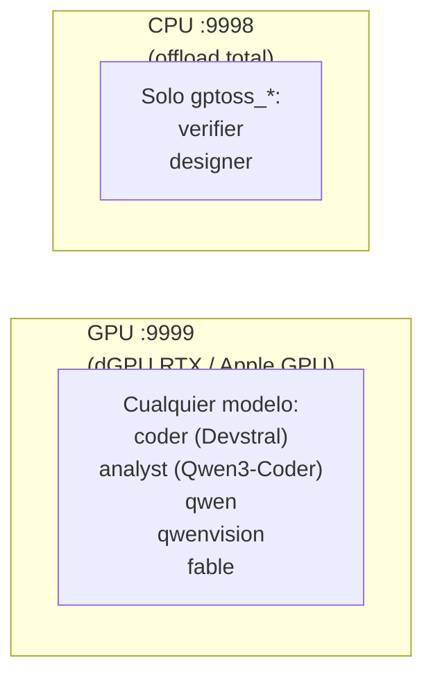

# ropero — lanzador de modelos locales

> Gestor simplificado de modelos de lenguaje. Añadir un modelo = añadir un
> archivo `.sh`. Ropera (de ahí el nombre) todos los motores bajo una misma CLI.

---

## ¿Qué es ropero?

**El problema**: tener 14 modelos con configuraciones distintas (llama-server,
MLX, AirLLM, TensorRT), cada uno con sus flags, sus GGUFs, sus contextos,
es un infierno.

**La solución**: un directorio de scripts (`ropero.d/`), cada uno describiendo
un modelo. `ropero` los descubre, los indexa y los lanza con la CLI correcta.

**Filosofía**: añadir un modelo = añadir un `.sh`. Nada más.

---

## Instalación

```bash
./ropero --install
./ropero --check
```

`--install`:

1. Instala dependencias (pacman/brew según OS).
2. Clona y compila `llama.cpp` (20-40 min la primera vez, con CUDA/Metal).
3. Instala `airllm` / `mlx-lm` / `tensorrt-llm` (best-effort, pregunta).
4. Descarga los GGUF por defecto (~50 GB).
5. Crea symlinks en `~/.local/bin` — **incluidos los ejecutables de los
   backends**, no sólo los de ropero. Ver más abajo.

`--check` verifica:

- Symlinks en `~/.local/bin/`.
- Que los ejecutables de los backends estén linkeados.
- Modelos GGUF descargados.
- `llama-server` compilado, en PATH, y **con su versión** (importa, ver más
  abajo).
- `BIN_DIR` en PATH.

### Los ejecutables de los backends también se linkean

`ropero` no es el único binario que acaba en `~/.local/bin`. También lo son los
ejecutables de los backends que compila o instala:

| Backend | Dónde vive | Qué se linkea |
|---|---|---|
| `llama.cpp` | `~/llama.cpp/build/bin/` | los 23+ (`llama-server`, `llama-cli`, `llama-bench`, `llama-quantize`…) |
| `tensorrt-llm` | `~/.venv-tensorrt/bin/` | los de su venv (CachyOS) |
| `airllm` | el `bin` del Python que lo instaló | `airllm`, `airllm-server` |
| `mlx-lm` | el `bin` del Python que lo instaló | `mlx_lm`, `mlx_lm.generate`, `mlx_lm.chat` |

Para `airllm` y `mlx_lm` la ruta no se puede escribir de antemano: cambian según
si se instalaron con `uv` o con `pip`, y según qué Python esté activo. Se
resuelve en runtime: se pregunta a los Pythons de asdf dónde ponen sus
console scripts.

**Por qué importa.** `mlx_lm` vivía sólo detrás del shim de asdf. Si esa versión
de Python se reinstalaba, el shim apuntaba al vacío y `mlx_lm` desaparecía sin
aviso. Con el symlink, sobrevive al Python.

**Aviso de shadowing.** Al linkear, ropero **tapa** cualquier binario del mismo
nombre que ya estuviera en el PATH. Casi siempre es lo que se quiere, pero
puede ser un downgrade sin que se note: si tienes un `llama-server` de Homebrew
más nuevo que el que compila ropero, el de ropero pasa a ganar. `--link` avisa
cuando lo detecta, y `--check` imprime la versión para que el cambio sea visible.

### `ropero --link`

Sólo rehace los symlinks. Existe para dos casos reales:

- has compilado `llama.cpp` a mano y quieres los symlinks sin re-ejecutar el
  `--install` entero (que vuelve a preguntar por los modelos);
- has instalado un backend por tu cuenta y quieres que ropero lo registre.

```bash
ropero --link
```

Idempotente y rápido: no compila, no descarga, no pregunta.

---

## Uso

### Listar modelos

```bash
ropero list
```

Salida:

```
Modelos disponibles:
  devstral     ctx=131072  gguf=Devstral-Small-2-24B-Instruct-2512-UD-Q4_K_XL.gguf  engine=llama-server
  coder        ctx=131072  gguf=Devstral-Small-2-24B-Instruct-2512-UD-Q4_K_XL.gguf  engine=llama-server
  analyst      ctx=131072  gguf=Qwen3-Coder-30B-A3B-Instruct-UD-Q4_K_XL.gguf  engine=llama-server
  ...
```

**Ojo**: cada modelo puede tener **dos nombres**:

- El nombre del script (`devstral`) → modelo físico.
- El alias público (`coder`) → nombre que usan los agentes de `gunter`.

Ambos apuntan al mismo proceso.

### Arrancar un modelo

```bash
# Primer plano (logs en pantalla, coloreados)
ropero analyst

# Background (logs a ~/.logs/ropero/)
ropero analyst --background

# En CPU (slot :9998, sin GPU)
ropero verifier --cpu --background

# Forzar si el slot destino está ocupado por otro
ropero coder --force --background
```

### Estado

```bash
ropero status              # resumen de ambos slots
ropero status --craft      # render artesanal (sin alaja)
ropero status --watch      # refresco continuo cada 1s
ropero status --watch 500  # refresco cada 500ms
```

Muestra:

- CPU/GPU GHz, RAM/VRAM, temp, fan RPM.
- Slots activos (`:9999` GPU, `:9998` CPU).
- Modelo, PID, uptime, engine.

### Parar

```bash
ropero stop analyst   # un modelo concreto
ropero stop all       # ambos slots
```

---

## Arquitectura — dual-slot



**Reglas**:

- GPU y CPU pueden coexistir con modelos distintos.
- `gptoss_*` es el único que va bien en CPU. Los demás van a GPU.
- `--cpu` arranca en `:9998` con todos los layers en CPU.
- `--force` mata el slot destino si está ocupado por otro modelo (no toca el otro slot).

---

## Estructura del repo

```mermaid
flowchart TD
    root["ropero/"]
    n0["ropero                     entry point (bash, dispatch)"]
    root --> n0
    n1["ropero.d/                  módulos"]
    root --> n1
    n2["_common.sh             helpers comunes"]
    n1 --> n2
    n3["_gptoss_common.sh      helper específico de gptoss"]
    n1 --> n3
    n4["00-utils.sh            helpers de logging / prompts"]
    n1 --> n4
    n5["01-env.sh              defaults de entorno (BIN_DIR, GGUF_DIR...)"]
    n1 --> n5
    n6["20-compile-llama.sh    compilación de llama.cpp (CMake flags)"]
    n1 --> n6
    n7["21-download-models.sh  descarga de los GGUF por defecto"]
    n1 --> n7
    n8["devstral.sh            modelo: Devstral (alias \"coder\")"]
    n1 --> n8
    n9["qwencoder.sh           modelo: Qwen3-Coder-30B (alias \"analyst\")"]
    n1 --> n9
    n10["qwen.sh                modelo: Qwen3.8-27B (alias \"analyst\" alt)"]
    n1 --> n10
    n11["gptoss_high.sh         modelo: gpt-oss reasoning high (alias \"verifier\")"]
    n1 --> n11
    n12["gptoss_medium.sh       modelo: gpt-oss reasoning medium (alias \"designer\")"]
    n1 --> n12
    n13["gptoss_low.sh          modelo: gpt-oss reasoning low"]
    n1 --> n13
    n14["embed.sh               modelo: embeddings (jina-code)"]
    n1 --> n14
    n15["qwenvision.sh          modelo: Qwen2.5-VL (visión)"]
    n1 --> n15
    n16["fable.sh               modelo: Fable Coder 35B"]
    n1 --> n16
    n17["fired/                 modelos fuera del scope actual (archivados)"]
    n1 --> n17
    n18["README.md                  este archivo"]
    root --> n18
    n19["CHANGELOG.md"]
    root --> n19
    n20["docs/"]
    root --> n20
    n21["model-eval.md          benchmarking de modelos"]
    n20 --> n21
```

---

## Añadir un modelo nuevo

### 1. Crear el script

```bash
cat > ropero.d/mi-modelo.sh <<'EOF'
#!/usr/bin/env bash
# mi-modelo.sh — Descripción del modelo

MODEL_ENGINE="llama-server"
MODEL_GGUF="mi-modelo-Q4_K_M.gguf"
MODEL_CTX="${ROPERO_MI_MODELO_CTX:-131072}"

# Alias público opcional (ropero lo registra como nombre alternativo)
MODEL_ALIAS="${MODEL_ALIAS:-mi-alias}"

get_model_args_mi_modelo() {
    local -a args=(
        --n-gpu-layers 999
        --no-kv-offload
        --cache-type-k q8_0
        --cache-type-v q8_0
        --jinja
        --temp 0.6
        --top-p 0.95
        --n-predict 4096
    )
    printf '%s\n' "${args[@]}"
}
EOF
```

### 2. (Opcional) Añadir descarga automática

En `ropero.d/21-download-models.sh`, añadir una línea:

```bash
ropero_download_gguf "repositorio/org/mi-modelo-GGUF" \
    "mi-modelo-Q4_K_M.gguf" "Mi Modelo Q4" "10 GB"
```

### 3. Probar

```bash
ropero list | grep mi-modelo
ropero mi-modelo --background
```

---

## Overrides por env

Cada modelo admite variables para no editar el `.sh`:

```bash
# Cambiar contexto
ROPERO_ANALYST_CTX=65536 ropero analyst

# Cambiar n-cpu-moe (offload a CPU)
ROPERO_CODER_N_CPU_MOE=40 ropero coder

# Ver todas las variables por modelo
grep -oE 'ROPERO_[A-Z_]+' ropero.d/*.sh | sort -u
```

Convención: `ROPERO_<MODELO>_<PARAM>`, con el nombre del modelo en
`UPPER_SNAKE_CASE` (guiones → guiones bajos).

---

## Dependencias

- **llama.cpp** compilado con CUDA (CachyOS) o Metal (macOS). Lo instala `--install`.
- **Python 3.11+** para AirLLM / MLX / TensorRT (opcional).
- **Homebrew** (macOS) o **pacman/paru** (CachyOS) para paquetes base.
- **jq**, **curl** (para checks).

---

## Motores soportados

| Engine         | Plataforma            | Modelo típico                     |
| -------------- | --------------------- | --------------------------------- |
| `llama-server` | Linux + macOS         | GGUF (Qwen, Devstral, gpt-oss...) |
| `mlx_lm`       | macOS (Apple Silicon) | safetensors MLX                   |
| `airllm`       | Cross-platform        | safetensors 120B                  |
| `tensorrt-llm` | CachyOS               | optimizado NVIDIA                 |

`llama-server` es el motor por defecto. Los demás son para casos concretos.

---

## Troubleshooting

| Problema                     | Causa                 | Fix                                       |
| ---------------------------- | --------------------- | ----------------------------------------- |
| `Archivo GGUF no encontrado` | Modelo no descargado  | `ropero --install` o descargar manual     |
| `Puerto :9999 ocupado por X` | Otro modelo en GPU    | `ropero stop X` o `ropero Y --force`      |
| `llama-server no en PATH`    | No compilado          | `ropero --install`                        |
| Modelo tarda mucho en cargar | Normal la primera vez | Espera 60-180s, logs en `~/.logs/ropero/` |
| `OOM` en GPU                 | Modelo no cabe entero | Subir `--n-cpu-moe` o bajar `MODEL_CTX`   |

---

## Integración con gunter

`gunter` (entorno IA) usa ropero para modelos locales:

- `_shunt-lib.sh` invoca `ropero <alias> --background` para `bulk-read` / `code-write`.
- `ropero status` es la fuente de verdad para saber qué modelo está en qué slot.
- Los aliases (`coder`, `analyst`, `verifier`, `designer`) son los que pide el `opencode.jsonc` de gunter.

Cambiar el modelo asociado a `coder`:

1. Editar `ropero.d/devstral.sh` (o el que sea).
2. `opencode.jsonc` y gunter no se enteran.
3. La próxima vez que se arranque `coder`, carga el nuevo modelo.

---

## Licencia

Uso personal. Repo privado.
