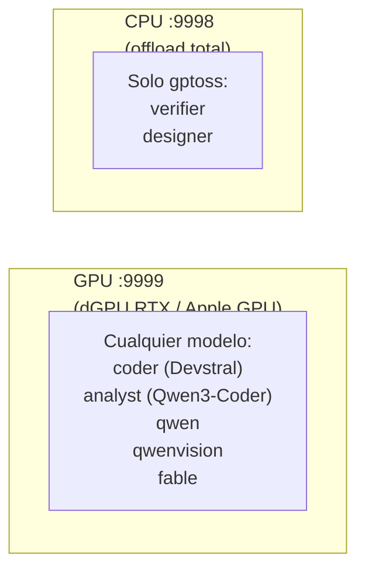

# ropero — lanzador de modelos locales

> Gestor simplificado de modelos de lenguaje. Añadir un modelo = añadir un
> archivo `.sh`. Ropera (de ahí el nombre) todos los motores bajo una misma CLI.

---

## ¿Qué es ropero?

**El problema**: tener 14 modelos con configuraciones distintas (llama-server,
MLX, AirLLM, TensorRT), cada uno con sus flags, sus GGUFs, sus contextos,
es un infierno.

**La solución**: un directorio de scripts (`ropero.d/`), cada uno describiendo
un modelo. `ropero` los descubre, los indexa y los lanza con la CLI correcta.

**Filosofía**: añadir un modelo = añadir un `.sh`. Nada más.

---

## Instalación

```bash
ropero --install              # SOLO ropero: entorno y sus symlinks
ropero install                # menú de engines y después menú de modelos
ropero install engines        # sólo engines compatibles
ropero install models         # catálogo de pesos seleccionables
ropero link                   # rehacer enlaces de lo ya instalado
ropero check                  # alias de --check, sólo lectura
```

`--install` ya no acepta targets: instala exclusivamente el lanzador y
`ropero.d`. El antiguo flujo de targets se sustituye por `ropero install`.
En una entrada sin TTY, `AUTO_YES=1` o `--force`, los menús eligen todos los
elementos compatibles; las confirmaciones destructivas continúan siendo
conservadoras.

| comando | qué hace |
| --- | --- |
| `ropero --install [--force]` | entorno y enlaces propios de ropero |
| `ropero install engines [selección]` | instala `llama`, `airllm`, `mlx`, `tensorrt` o `flm` compatibles |
| `ropero install models [selección]` | descarga modelos del catálogo |
| `ropero config [engine]` | muestra configuración efectiva, puertos y disco |

El menú de engines usa `1 llama`, `2 airllm`, `3 mlx` (macOS Apple Silicon), `4 tensorrt`
(Linux + NVIDIA RTX), `5 flm` (Linux + CPU AMD), `9 todos` y `0 salir`.
Admite varias selecciones por coma, punto y coma o espacio. El de modelos usa
las mismas separaciones, `99 todos` y `0 salir`; las filas incompatibles o sin
descarga no se pueden seleccionar.

> **Migración externa:** `../repos.yaml` todavía contiene `./ropero --install`.
> Ahora sólo instalará ropero; si necesita engines/modelos deberá migrarse a
> `./ropero install` según la política del repo padre.

`install link` existe para rehacer los symlinks de lo ya instalado sin instalar
paquetes ni pesos. Las selecciones explícitas no interactivas aceptan alias,
nombres de catálogo o sus números; los modelos incompatibles/no descargables se
omiten y cuentan en el resumen. Las entradas de catálogo sin launcher se pueden
pedir por su clave o nombre explícito: se descargan, pero no reciben número si
no se puede inferir con seguridad el engine que las usaría.

`--check` verifica:

- Symlinks en `~/.local/bin/`.
- Que los ejecutables de los backends estén linkeados.
- Modelos GGUF descargados.
- `llama-server` compilado, en PATH, y **con su versión** (importa, ver más
  abajo).
- `BIN_DIR` en PATH.

### Cada engine linkea lo suyo al terminar de instalarse

`ropero install engines` recorre los engines uno a uno, y **cada uno enlaza sus
ejecutables en cuanto acaba** — no hay un paso final "enlaza todo":

| Engine | Dónde vive | Qué se linkea |
|---|---|---|
| `llama.cpp` | `~/llama.cpp/build/bin/` | los 23+ (`llama-server`, `llama-cli`, `llama-bench`, `llama-quantize`…) |
| `tensorrt-llm` | `~/.venv-tensorrt/bin/` | **sólo** los `trtllm-*` (CachyOS) |
| `airllm` | el `bin` del Python que lo instaló | `airllm`, `airllm-server` |
| `mlx-lm` | el `bin` del Python que lo instaló | `mlx_lm`, `mlx_lm.generate`, `mlx_lm.chat` |

La relación es 1:1. Si instalas sólo `llama.cpp`, los enlaces que aparecen son
los de `llama.cpp`; saltarte un engine no deja ninguno suyo suelto.

**Por qué importa el link.** `mlx_lm` vivía sólo detrás del shim de asdf. Si esa
versión de Python se reinstalaba, el shim apuntaba al vacío y `mlx_lm`
desaparecía sin aviso. Con el symlink, sobrevive al Python.

**Por qué `tensorrt-llm` sólo linkea `trtllm-*`.** `~/.venv-tensorrt/bin` es un
venv, no un directorio de herramientas: dentro hay 69 ejecutables, pero sólo 7
son de tensorrt. Los otros 62 son activadores y scripts de Python que el venv
trae de paso — incluidos `python`, `python3` y `pydoc.bat`. Enlazarlos pondría el
`python3` del venv por delante del shim de asdf en el PATH de todo el sistema, y
a partir de ahí cualquier `python3` ejecutaría el venv de tensorrt.

**AirLLM y mlx-lm se buscan por nombre.** La ruta no se puede escribir de
antemano: cambia según si se instalaron con `uv` o con `pip`, y según qué Python
esté activo. Se resuelve en runtime (preguntando a los Pythons de asdf dónde
ponen sus console scripts) y se enlaza **por nombre exacto**, nunca "lo que haya
en el directorio": un paquete de Python trae dependencias que se instalan como
ejecutables (`ninja`, `hf`, `wheel`…) y linkearlas ganaría al resto del sistema.

**Aviso de shadowing.** Al linkear, ropero **tapa** cualquier binario del mismo
nombre que ya estuviera en el PATH. Casi siempre es lo que se quiere, pero
puede ser un downgrade sin que se note: si tienes un `llama-server` de Homebrew
más nuevo que el que compila ropero, el de ropero pasa a ganar. El install avisa
cuando lo detecta, y `--check` imprime la versión para que el cambio sea visible.

---

## Uso

### Listar modelos

```bash
ropero list
```

Salida:

```
Modelos disponibles:
  devstral     ctx=131072  gguf=Devstral-Small-2-24B-Instruct-2512-UD-Q4_K_XL.gguf  engine=llama-server
  coder        ctx=131072  gguf=Devstral-Small-2-24B-Instruct-2512-UD-Q4_K_XL.gguf  engine=llama-server
  analyst      ctx=131072  gguf=Qwen3-Coder-30B-A3B-Instruct-UD-Q4_K_XL.gguf  engine=llama-server
  ...
```

**Ojo**: cada modelo puede tener **dos nombres**:

- El nombre del script (`devstral`) → modelo físico.
- El alias público (`coder`) → nombre que usan los agentes de `gunter`.

Ambos apuntan al mismo proceso.

### Arrancar un modelo

```bash
# Primer plano (logs en pantalla, coloreados)
ropero analyst

# Background (logs a ~/.logs/ropero/)
ropero analyst --background

# En CPU (slot :9998, sin GPU)
ropero verifier --cpu --background

# Forzar si el slot destino está ocupado por otro
ropero coder --force --background

# Puerto puntual, sin editar el .sh del modelo
ropero embed --port 9995 --background
```

### Argumentos que declara el modelo

Además de los flags globales (`--background`, `--cpu`, `--force`, `--port`),
cada modelo puede declarar **niveles**, **flags** y **opciones** propias. El
CLI no tiene vocabulario propio: lo que el `.sh` del modelo no declara, es un
error de uso.

```bash
ropero gptoss --high           # nivel (gptoss: low|medium|high)
ropero gemma --vision          # flag booleano
ropero gemma --n-cpu-moe 8     # opción con valor
```

Un alias público puede traer su nivel por defecto, y el flag explícito gana
sobre él:

| invocación | nivel |
|---|---|
| `ropero gptoss` | medium |
| `ropero gptoss --high` | high |
| `ropero verifier` | high (su alias) |
| `ropero verifier --low` | low (el flag manda) |

### gpt-oss: un solo modelo, el nivel por argumento

Antes eran cuatro scripts (`gptoss_high` / `gptoss_medium` / `gptoss_low` /
`gptossfallback`) con la misma tabla de n-gramas copiada en varios sitios. Ahora
hay **un** `ropero.d/gptoss.sh` con el nivel como argumento, y la tabla vive en
una sola función.

- GGUF: `gpt-oss-20b-UD-Q8_K_XL.gguf` (13,2 GB). Es el que está en disco, y el
  que ya usaba el fallback: con él como modelo único, el "seguro frío" deja de
  ser un segundo modelo y era una duplicación que solo servía para tener dos
  contextos que calibrar.
- Contexto 65536 (no 131072): con el Q8_K_XL la KV en q8_0 a 131072 son 3,19
  GiB y no caben en 16 GB junto a los pesos.
- Aliases: `verifier` (high) y `designer` (medium) — los pide el
  `opencode.jsonc` de gunter, no son nuestros.

### `--port` vs `MODEL_PORT`

| | Cuándo | Dónde se define | Sobrevive al comando |
|---|---|---|---|
| `MODEL_PORT` | el modelo SIEMPRE vive en ese puerto | en su `.sh` de `ropero.d/` | sí |
| `--port N` | solo este arranque | en la línea de comandos | no |

Precedencia: `--port` > `MODEL_PORT` > `--cpu` (`:9998`) > `:9999` (GPU).

Los puertos de `--port` se recuerdan en `~/.logs/ropero/ad-hoc-ports`, para que
`ropero status` los liste (columna `SLOT` = `ad-hoc`) y `ropero stop <modelo>` los
encuentre. Se borran del registro al parar el modelo, así que no se acumulan.


### Estado

```bash
ropero status              # resumen de ambos slots
ropero status --craft      # render artesanal (sin alaja)
ropero status --watch      # refresco continuo cada 1s
ropero status --watch 500  # refresco cada 500ms
```

Muestra:

- CPU/GPU GHz, RAM/VRAM, temp, fan RPM.
- **Todos los puertos configurados**, no solo los activos: los dos slots por
  defecto (`:9999` GPU, `:9998` CPU) más los que hayan pineado los modelos con
  `MODEL_PORT`. Cada fila indica si está `ON` u `OFF`, su modelo, PID, uptime y
  engine. La columna `SLOT` dice quién vive en ese puerto.
- Modelo, PID, uptime, engine.

`status` delega en `alaja` para el render, y cae al render artesanal si no está
o si no imprime nada (p. ej. un binario de `alaja` a medio compilar).

### Parar

```bash
ropero stop analyst   # un modelo concreto
ropero stop all       # ambos slots
```

---

## Arquitectura — dual-slot



**Reglas**:

- GPU y CPU pueden coexistir con modelos distintos.
- `gptoss` (y sus alias `verifier` / `designer`) es el único que va bien en CPU. Los demás van a GPU.
- `--cpu` arranca en `:9998` con todos los layers en CPU.
- `--port N` arranca en `N`, saltándose `MODEL_PORT` y los slots. No edita el
  `.sh`: el siguiente arranque vuelve al puerto de siempre.
- `--force` mata el slot destino si está ocupado por otro modelo (no toca el otro slot).

---

## Gemma 4 26B-A4B QAT (experimental)

Según la [guía de Unsloth](https://unsloth.ai/docs/models/gemma-4/qat), se usan tres archivos del mismo repositorio en `GGUF_DIR` (por defecto `~/models/gguf`):
- Modelo: `gemma-4-26B-A4B-it-qat-UD-Q4_K_XL.gguf`.
- MTP: `mtp-gemma-4-26B-A4B-it.gguf`.
- Proyector: `gemma-4-26B-A4B-it-mmproj-BF16.gguf` (nombre propio para evitar colisiones).

```bash
./ropero install models gemma     # descarga el bundle entero
./ropero gemma                    # texto puro, sin visión
./ropero gemma --vision           # añade el proyector: el modelo lee imágenes
./ropero gemma --n-cpu-moe 8      # 8 capas de expertos MoE en la CPU (más hueco en VRAM)
./ropero gemma --high             # razonamiento + CoT conservado en el historial
./ropero gemma --low              # sin razonamiento: respuesta directa
```

Los tres archivos son un **bundle**: se descargan juntos y con **un solo
consentimiento** (15.7 GB en total). No es un extra opcional: con el GGUF
solo, `llama-server` arranca y se cae al primer uso, porque `--model-draft` y
`--mmproj` apuntan a ficheros que no existen.

El proyector se descarga a un temporal y se mueve a su nombre final: en el
repo se llama `mmproj-BF16.gguf`, igual que el de Qwen3.8, y descargado
directo a `GGUF_DIR` uno pisaría al otro.

### La visión es opt-in

`ropero gemma` arranca **sin** el mmproj: son 1139 MiB de VRAM, y el 95% de
lo que se le pide a un modelo de texto no lo necesita. Con `--vision` el
modelo lee imágenes.

| config | mmproj | `--n-cpu-moe` (default) | VRAM |
|---|:-:|---:|---:|
| `ropero gemma` | no | 0 (todo en GPU) | ~14,6 GiB |
| `ropero gemma --vision` | sí | 5 (5 capas de expertos a la CPU) | ~15,7 GiB |

El default cambia **según el caso**, y `--n-cpu-moe N` lo ajusta en los dos
(`ropero gemma --n-cpu-moe 2`, `ropero gemma --vision --n-cpu-moe 8`): cada
capa de expertos MoE que baja a la RAM libera ~0,46 GB de VRAM, que es
justo lo que necesita el mmproj para entrar.

Medido en una RTX 5080 Laptop (16 GB) con la config de `ropero.d/gemma.sh`:
104-140 tok/s y una aceptación de MTP del 49-88% según el prompt. La KV cache
se queda en RAM a propósito (`--no-kv-offload`): a 131072 en q8_0 son 1139 MiB
y en la tarjeta no caben junto al modelo.

### El nivel de razonamiento

Gemma 4 **no** tiene `reasoning_effort` como gpt-oss: su chat template solo
conoce `enable_thinking` y `preserve_thinking`. Los niveles se traducen a sus
knobs reales:

| nivel | qué hace |
|---|---|
| `--low` | `enable_thinking=false` → respuesta directa, sin CoT |
| `--medium` | `enable_thinking=true` → razona y responde (default) |
| `--high` | `+ preserve_thinking` → conserva el CoT anterior en el historial (agentic con tool calls) |

Con thinking activo, el CoT sale limpio en el campo `reasoning_content` de la
API: `llama-server` sabe parsear el bloque `<|channel>thought` de Gemma 4.

Requieren un build reciente de llama.cpp con `gemma4-assistant`, sin
autocompilación. Configuraciones orientativas: sin garantía de ajuste en
CUDA de 16 GiB ni de contexto lleno.

> `ROPERO_DOWNLOADER=hf|curl` fuerza el descargador (`auto` por defecto: `hf`
> si está, `curl` si no). Útil cuando el `hf` del sistema está roto.

---

## Estructura del repo

```mermaid
flowchart TD
    root["ropero/"]
    n0["ropero                     entry point (bash, dispatch)"]
    root --> n0
    n1["ropero.d/                  módulos"]
    root --> n1
    n2["_common.sh             helpers comunes"]
    n1 --> n2
    n3["gptoss.sh               modelo: gpt-oss-20b (nivel por argumento)"]
    n1 --> n3
    n4["00-utils.sh            helpers de logging / prompts"]
    n1 --> n4
    n5["01-env.sh              defaults de entorno (BIN_DIR, GGUF_DIR...)"]
    n1 --> n5
    n6["20-compile-llama.sh    compilación de llama.cpp (CMake flags)"]
    n1 --> n6
    n7["21-download-models.sh  descarga de los GGUF por defecto"]
    n1 --> n7
    n8["gemma.sh               modelo: Gemma 4 26B-A4B (MTP + visión)"]
    n1 --> n8
    n9["qwencoder.sh           modelo: Qwen3-Coder-30B (alias \"analyst\")"]
    n1 --> n9
    n10["ministral.sh           modelo: Ministral 3 14B (alias \"vault\")"]
    n1 --> n10
    n11["qwen3ranker.sh         modelo: reranker (alias \"ranker\")"]
    n1 --> n11
    n12["qwen3vector.sh         modelo: embeddings (alias \"vector\")"]
    n1 --> n12
    n13["qwenvision.sh          modelo: Qwen2.5-VL (visión)"]
    n1 --> n13
    n17["fired/                 modelos fuera del scope actual (archivados)"]
    n1 --> n17
    n18["README.md                  este archivo"]
    root --> n18
    n19["CHANGELOG.md"]
    root --> n19
    n20["docs/"]
    root --> n20
    n21["model-eval.md          benchmarking de modelos"]
    n20 --> n21
```

---

## Añadir un modelo nuevo

### 1. Crear el script

```bash
cat > ropero.d/mi-modelo.sh <<'EOF'
#!/usr/bin/env bash
# mi-modelo.sh — Descripción del modelo

MODEL_ENGINE="llama-server"
MODEL_GGUF="mi-modelo-Q4_K_M.gguf"
MODEL_CTX="${ROPERO_MI_MODELO_CTX:-131072}"

# Alias público opcional (ropero lo registra como nombre alternativo)
MODEL_ALIAS="${MODEL_ALIAS:-mi-alias}"

get_model_args_mi_modelo() {
    local -a args=(
        --n-gpu-layers 999
        --no-kv-offload
        --cache-type-k q8_0
        --cache-type-v q8_0
        --jinja
        --temp 0.6
        --top-p 0.95
        --n-predict 4096
    )
    printf '%s\n' "${args[@]}"
}
EOF
```

### 2. (Opcional) Añadir descarga automática

En `ropero.d/21-download-models.sh`, añadir una línea:

```bash
ropero_download_gguf "repositorio/org/mi-modelo-GGUF" \
    "mi-modelo-Q4_K_M.gguf" "Mi Modelo Q4" "10 GB"
```

### 3. Probar

```bash
ropero list | grep mi-modelo
ropero mi-modelo --background
```

---

## Overrides por env

Cada modelo admite variables para no editar el `.sh`:

```bash
# Cambiar contexto
ROPERO_ANALYST_CTX=65536 ropero analyst

# Cambiar n-cpu-moe (offload a CPU)
ROPERO_CODER_N_CPU_MOE=40 ropero coder

# Ver todas las variables por modelo
grep -oE 'ROPERO_[A-Z_]+' ropero.d/*.sh | sort -u
```

Convención: `ROPERO_<MODELO>_<PARAM>`, con el nombre del modelo en
`UPPER_SNAKE_CASE` (guiones → guiones bajos).

---

## Dependencias

- **llama.cpp** compilado con CUDA (CachyOS) o Metal (macOS). Lo instala `ropero install engines`.
- **Python 3.11+** para AirLLM / MLX / TensorRT (opcional).
- **Homebrew** (macOS) o **pacman/paru** (CachyOS) para paquetes base.
- **jq**, **curl** (para checks).

---

## Motores soportados

| Engine         | Plataforma            | Modelo típico                     |
| -------------- | --------------------- | --------------------------------- |
| `llama-server` | Linux + macOS         | GGUF (Qwen, Devstral, gpt-oss...) |
| `mlx_lm`       | macOS (Apple Silicon) | safetensors MLX                   |
| `airllm`       | Cross-platform        | safetensors 120B                  |
| `tensorrt-llm` | CachyOS               | optimizado NVIDIA                 |

`llama-server` es el motor por defecto. Los demás son para casos concretos.

---

## Troubleshooting

| Problema                     | Causa                 | Fix                                       |
| ---------------------------- | --------------------- | ----------------------------------------- |
| `Archivo GGUF no encontrado` | Modelo no descargado  | `ropero install models` o descargar manual |
| `Puerto :9999 ocupado por X` | Otro modelo en GPU    | `ropero stop X` o `ropero Y --force`      |
| `llama-server no en PATH`    | No compilado          | `ropero install engines`                  |
| Modelo tarda mucho en cargar | Normal la primera vez | Espera 60-180s, logs en `~/.logs/ropero/` |
| `OOM` en GPU                 | Modelo no cabe entero | Subir `--n-cpu-moe` o bajar `MODEL_CTX`   |

---

## Integración con gunter

`gunter` (entorno IA) usa ropero para modelos locales:

- `_shunt-lib.sh` invoca `ropero <alias> --background` para `bulk-read` / `code-write`.
- `ropero status` es la fuente de verdad para saber qué modelo está en qué slot.
- Los aliases (`coder`, `analyst`, `verifier`, `designer`) son los que pide el `opencode.jsonc` de gunter.

Cambiar el modelo asociado a `coder`:

1. Editar `ropero.d/devstral.sh` (o el que sea).
2. `opencode.jsonc` y gunter no se enteran.
3. La próxima vez que se arranque `coder`, carga el nuevo modelo.

---

## Licencia

Uso personal. Repo privado.
