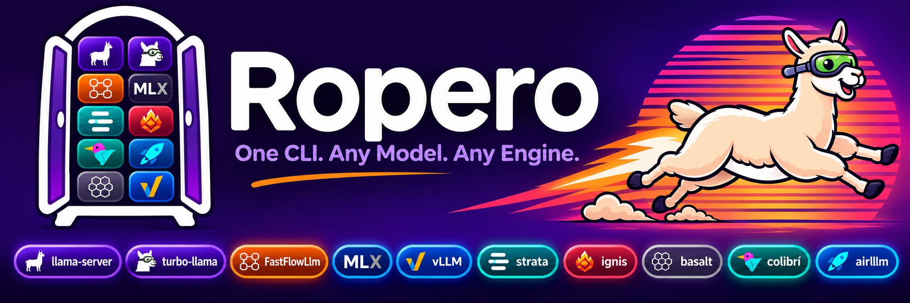

# Ropero

**Instale e execute modelos de IA localmente.**

[English](README.md) · [Español](README.es.md) · **Português** · [Français](README.fr.md) · [Deutsch](README.de.md) · [Italiano](README.it.md) · [日本語](README.ja.md) · [简体中文](README.zh-CN.md) · [한국어](README.ko.md) · [Русский](README.ru.md)

O Ropero organiza modelos locais e os mecanismos que os executam. Escolha um modelo; o Ropero prepara o mecanismo declarado, inicia o serviço, verifica se está pronto e oferece uma API compatível com OpenAI quando disponível.

## O que oferece

- Instalação separada de mecanismos (`ropero install engines`) e modelos (`ropero install models`).
- Catálogo declarativo em TOML para requisitos, downloads e parâmetros de execução.
- Inicialização, monitoramento e encerramento dos serviços de modelos.
- Diagnóstico, informações de configuração, comandos de execução e avaliações.
- Integrações com assistentes de código compatíveis; cada uma tem seus próprios limites.

## Começar

Este repositório contém a versão 2 do Ropero, ainda em desenvolvimento. Compile na raiz:

```bash
cargo build --locked --release -p ropero-cli
ropero --help
ropero doctor
ropero install engines
```

O comando de mecanismos lista as opções disponíveis. Também é possível escolher uma diretamente, por exemplo `ropero install engines basalt`. Instale o modelo separadamente com `ropero install models <modelo>`.

## Modelos e uso

Os manifestos em `engines/` descrevem mecanismos e instalação; `models/<mecanismo>/` contém definições TOML de modelos. No uso normal, o catálogo fica em `~/.config/ropero/models/`. Os TOML deste repositório são referências e não são carregados automaticamente.

```bash
ropero models add
ropero models add --path modelo.toml
ropero <modelo>
ropero status --live
```

Consulte os guias detalhados em [espanhol](docs/engine-support.es.md) e [inglês](docs/engine-support.en.md), a [referência do CLI](docs/especificacion/ropero-cli.en.md) e a [guia de integrações](docs/agent-integrations.en.md). Consulte também o [guia do usuário em português](docs/guide.pt.md). Os guias do usuário estão disponíveis em dez idiomas; as referências detalhadas de compatibilidade e integração estão atualmente em inglês e espanhol.
