# ropero.d/ — FÍSICO + ALIAS público (v5.0)

> **Cada `.sh` (sin prefijo `_`) es un modelo físico que lanza `llama-server`.** Algunos declan un `MODEL_ALIAS` público, así `ropero` registra tanto el nombre físico (`devstral`, `gptoss_high`, ...) como el alias humano (`coder`, `verifier`, ...) que `opencode.jsonc` usa.

## Mapa completo

```mermaid
flowchart TD
    root["ropero.d/"]
    n0["PHYSICAL LAYER (lanzan llama-server, fuente de verdad del binding)"]
    root --> n0
    n1["devstral.sh         → Devstral-Small-2-24B-Instruct     alias: coder      (GPU :9999)"]
    n0 --> n1
    n2["qwencoder.sh        → Qwen3-Coder-30B-A3B-Instruct      alias: analyst    (GPU :9999)"]
    n0 --> n2
    n3["gptoss_high.sh      → gpt-oss-20b MXFP4, high           alias: verifier   (CPU :9998)"]
    n0 --> n3
    n4["gptoss_medium.sh    → gpt-oss-20b MXFP4, medium         alias: designer   (CPU :9998)"]
    n0 --> n4
    n5["gptoss_low.sh       → gpt-oss-20b MXFP4, low            (sin alias público)"]
    n0 --> n5
    n6["qwen.sh             → Qwen3.8-27B-Instruct              (sin alias público)"]
    n0 --> n6
    n7["embed.sh            → embeddings"]
    n0 --> n7
    n8["airgptoss.sh        → gpt-oss-120b (airllm)"]
    n0 --> n8
    n9["fable.sh            → fable-coder 35B-A3B (legacy)"]
    n0 --> n9
    n10["qwenvision.sh       → Qwen2.5-VL-7B-Instruct"]
    n0 --> n10
    n11["HELPERS (no son modelos; sourceados por el entry point)"]
    root --> n11
    n12["_common.sh          colorize y utilidades"]
    n11 --> n12
    n13["_gptoss_common.sh   args compartidos de gptoss_{low,medium,high}"]
    n11 --> n13
    n14["00-utils.sh, 01-env.sh"]
    n11 --> n14
    n15["20-compile-llama.sh, 21-download-models.sh"]
    n11 --> n15
    n16["README.md (este archivo)"]
    root --> n16
    n17["fired/                                ← modelos legacy, NO usar"]
    root --> n17
    n18["fable.sh                          (Fable Coder 35B-A3B, retirado)"]
    n17 --> n18
    n19["qwopus.sh                         (Qwopus 35B-A3B, retirado)"]
    n17 --> n19
    n20["muse.sh                           (Muse Glimmer 30B MoE, retirado)"]
    n17 --> n20
    n21["nemotron.sh                       (Nemotron 3.5 Lightning 30B-A3B, retirado)"]
    n17 --> n21
```



## Modelo selection (v5.0)

| Alias (opencode.jsonc) | Físico                       | Slot       | VRAM / RAM       | Uso                              |
| ---------------------- | ---------------------------- | ---------- | ---------------- | -------------------------------- |
| `coder`                | `devstral.sh`                | GPU :9999  | 14.5 GB VRAM     | Implementación principal         |
| `analyst`              | `qwencoder.sh`               | GPU :9999  | 16 GB GPU + 1.7 GB CPU offload | Análisis, agentic            |
| `verifier`             | `gptoss_high.sh`             | CPU :9998  | 14 GB RAM        | Razonamiento profundo, validación |
| `designer`             | `gptoss_medium.sh`           | CPU :9998  | 14 GB RAM        | Creatividad, UX/UI               |
| `qwen` (sin alias)     | `qwen.sh`                    | GPU :9999  | 12.5 GB VRAM     | Análisis broad (sustituye histórico) |

## Cómo añadir el alias público a un script

Cada script que deba ser invocable desde `opencode.jsonc` declara una línea en su cabecera:

```bash
MODEL_ALIAS="${MODEL_ALIAS:-coder}"   # valor por defecto; override con env
```

`bin/ropero` lee esa variable al cargar el script y registra la key alias junto a la del nombre físico. `cmd_list` muestra ambos nombres como modelos disponibles.

## Dual-slot coexistencia

- **CPU slot (`:9998`)**: gpt-oss-20b corre aquí. `verifier` y `designer` comparten script físico (distinto `reasoning_effort`).
- **GPU slot (`:9999`)**: Solo UN modelo GPU activo a la vez. `coder` y `analyst` (y `qwen`) son mutuamente exclusivos.

## Cómo descargar los modelos

Los scripts buscan los modelos en estas rutas por defecto:

```bash
~/.cache/models/devstral/Devstral-Small-2-24B-Instruct-2512-Q4_K_M.gguf
~/.cache/models/gpt-oss/openai_gpt-oss-20b-MXFP4.gguf
~/.cache/models/qwen/Qwen3-8B-27B-Instruct-Q3_K_XL.gguf
```

Si los tienes en otro path, edita `MODEL_FILE=` y/o `ALT_PATHS=` en cada script.

### Comandos de descarga (HF)

```bash
# Devstral-Small-2-24B-Instruct (Mistral, 14.5 GB Q4_K_M)
hf download mistralai/Devstral-Small-2-24B-Instruct-2512-GGUF \
    --include 'Devstral-Small-2-24B-Instruct-2512-Q4_K_M.gguf' \
    --local-dir ~/.cache/models/devstral/

# gpt-oss-20b (OpenAI, ~13 GB MXFP4)
hf download openai/gpt-oss-20b-GGUF \
    --include 'openai_gpt-oss-20b-MXFP4.gguf' \
    --local-dir ~/.cache/models/gpt-oss/

# Qwen3-27B-Instruct (Alibaba, 12.5 GB Q3_K_XL)
hf download Qwen/Qwen3-27B-Instruct-GGUF \
    --include 'Qwen3-27B-Instruct-Q3_K_XL.gguf' \
    --local-dir ~/.cache/models/qwen/
```

> **Proveedor preferido**: `unsloth` > `bartowski` > `mnotex` para HF GGUF.
> Si usas `bartowski`, el nombre del archivo puede cambiar — ajusta `MODEL_FILE`.

## Cómo swapear un modelo (1 línea)

**Para cambiar el alias `coder` de Devstral a Qwen3-Coder-30B-A3B**, dos opciones:

**(a) Cambiar el binding del alias:** edita `bin/ropero.d/qwencoder.sh` y ponle el alias `coder` (queda accesible como `ropero coder` corriendo el modelo físico de Qwen3-Coder). Si quieres que `coder` siga apuntando al script físico Devstral pero con otro GGUF, edita `bin/ropero.d/devstral.sh` (cambia `MODEL_GGUF` + args). **NO necesitas tocar `opencode.jsonc`** — el alias sigue siendo `coder`.

**(b) Apuntar `coder` a otro script:** pon en `bin/ropero.d/devstral.sh` el alias que prefieras (o vacío) y reserva el alias `coder` para el script que elijas. El registro de aliases se re-evalúa en cada arranque de `ropero`.

Tras cualquier cambio, `gunter smoke` para verificar.

## Variables de entorno reconocidas

| Variable                       | Default | Usado por              | Significado                          |
| ------------------------------ | ------- | ---------------------- | ------------------------------------ |
| `LLAMA_SERVER_BIN`             | `llama-server` | todos los físicos | Path al binario de llama.cpp         |
| `ROPERO_DEVSTRAL_CTX`          | 131072  | `devstral.sh`          | Override de context length (alias `coder`) |
| `ROPERO_CODER_CTX`             | 131072  | `qwencoder.sh`         | Override de context length (alias `analyst`) |
| `ROPERO_GPTOSS_HIGH_CTX`       | 131072  | `gptoss_high.sh`       | Override de context length (alias `verifier`) |
| `ROPERO_GPTOSS_MEDIUM_CTX`     | 131072  | `gptoss_medium.sh`     | Override de context length (alias `designer`) |
| `ROPERO_QWEN_CTX`              | 131072  | `qwen.sh`              | Override de context length (alias físico `qwen`) |
| `CODER_PORT` / `VERIFIER_PORT` / `ANALYST_PORT` / `DESIGNER_PORT` | 9999/9998/9999/9998 | aliases | Override de puerto por alias |
| `FORCE_GPTOSS`                 | unset   | `gptoss_{low,medium,high}.sh` | Si está, skip RAM check         |

## Cuándo un modelo NO está disponible

Si un script físico no encuentra el archivo `.gguf`, imprime:

```
[devstral-24b] ERROR: modelo no encontrado.
  Esperado en: ~/.cache/models/devstral/Devstral-Small-2-24B-Instruct-2512-Q4_K_M.gguf
  Descarga con: hf download mistralai/Devstral-Small-2-24B-Instruct-2512-GGUF ...
```

El alias lo recibe y termina con exit code 1. NO lanza el modelo. El smoke test debe pasar antes de cualquier delegación.

## Fallback chain (recomendado)

Si el modelo físico del alias primario no responde, configura manualmente en su script:

```bash
# En bin/ropero.d/devstral.sh, al final:
if ! curl -sf "${HOST}:${PORT}/health" >/dev/null 2>&1; then
    echo "[devstral] Primary failed, trying fallback..." >&2
    source "${HOME}/bin/ropero.d/qwencoder.sh"
    MODEL_GGUF="$MODEL_GGUF"
    # ... retry launch con get_model_args_qwencoder
fi
```

Por defecto v5.0 **NO incluye fallback automático** (cada swap cuesta 5-15s). Si lo necesitas, añádelo explícitamente.
