# ropero.d/ — FÍSICO + ALIAS público + engines (v6.0)

> **Cada `.sh` (sin prefijo `_`, sin `-template-` en el nombre) es un modelo físico.** Algunos declan un `MODEL_ALIAS` público, así `ropero` registra tanto el nombre físico (`devstral`, `gptoss_high`, ...) como el alias humano (`coder`, `verifier`, ...) que `opencode.jsonc` usa.

## Los cinco engines

ropero publica **todos** los engines en el **mismo puerto y con la misma `API_KEY`**, para que `opencode.jsonc` no tenga que saber qué hay detrás.

| Engine | Binario | SO / HW | ¿Valida la API key? | Servidor |
| --- | --- | --- | --- | --- |
| `llama-server` | `~/llama.cpp/build/bin/llama-server` | todos (Metal en macOS, CUDA en cachy) | **sí** (`--api-key`) | propio de llama.cpp |
| `airllm` | `airllm-server` → `ropero.d/_airllm_server.py` | todos | **sí** (el nuestro, `--api-key`) | **nuestro**: airllm es librería pura y no trae ninguno |
| `mlx_lm` | `mlx_lm.server` | macOS / Apple Silicon | **no** | + `_authproxy.py` |
| `tensorrt-llm` | `trtllm-serve` (`~/.venv-tensorrt`) | cachy/arch / NVIDIA | **no** | + `_authproxy.py` |
| `fastflowlm` | `flm` (`/opt/fastflowlm`) | cachy/arch / **NPU AMD** | **no** | + `_authproxy.py` |

### Por qué hay un proxy de auth

Sólo `llama-server` trae `--api-key`. Está verificado en el CLI de los otros tres:

- `mlx_lm.server` (0.31.3): ni flag ni variable de entorno de auth.
- `trtllm-serve` (1.x): no existe `--api_key`. El `api_key="tensorrt_llm"` de la doc oficial es el campo que *exige el SDK de OpenAI*, no una comprobación del servidor.
- `flm serve`: su propia documentación dice *"the key is not checked"*.

Con `HOST=0.0.0.0` y sin auth, esos tres quedarían abiertos a la LAN. Así que ropero les pone delante `ropero.d/_authproxy.py`:

```
opencode ──► :9992 (proxy, exige LLAMA_API_KEY) ──127.0.0.1:10992──► mlx_lm.server
```

Cuatro cosas de este diseño que importan:

1. **El engine real solo escucha en loopback**, en un puerto **fijo por engine**, no derivado del de ropero:

   | engine | puerto interno |
   |---|---|
   | `mlx_lm` | `10992` |
   | `airllm` | `11999` |
   | `tensorrt-llm` | `12999` |
   | `fastflowlm` | `13999` |

   Así `--port 9995` no mueve el engine, y dos engines distintos nunca se pisan (antes airllm, tensorrt-llm y fastflowlm caían todos en el mismo `+1000`). Si el puerto está ocupado sube de uno en uno hasta +49. Ver `ropero_engine_internal_port`. La API key del proxy no tiene puerta trasera.
2. **El proxy es el padre del engine**, así que un solo `kill` en el puerto de ropero apaga el árbol entero. Por eso `cmd_stop` manda **SIGTERM antes que SIGKILL**: con `kill -9` el proxy muere sin ejecutar su handler y el engine se queda sirviendo en `:10xxx` para siempre, invisible para `ropero status`.
3. **El proxy responde `/v1/models` con el nombre del modelo de ropero** y expone `/ropero/engine`. Eso es lo que hace que `ropero stop <modelo>`, la columna MODELO del status y la columna ENGINE funcionen igual para todos los engines, sin un caso especial por engine.
4. **Si el engine sólo acepta un nombre de modelo, el proxy lo reescribe** (`--rewrite-model`, lo decide `ropero_engine_pinned_model`). Ahora mismo sólo aplica a `mlx_lm`, que acepta únicamente `default_model` y trata cualquier otro nombre como un **repo_id de HuggingFace**: sin esto, un cliente que manda `"model": "gptoss"` recibe un 404 con `Repository Not Found for url: .../api/models/gptoss` — un error que habla de descargas y no de nombres, con el modelo ya en disco y cargado. El engine no tiene flag para fijarlo (ni `--alias` ni `--served-model-name`), y `/v1/models` anuncia el id de ropero, así que el proxy es el único sitio donde se puede normalizar. Por eso en el `opencode.jsonc` da igual qué nombre le pongas al modelo.

`ROPERO_NO_AUTH_PROXY=1` lo desactiva (y avisa). Sólo tiene sentido con `HOST=127.0.0.1`.

## Mapa completo

```mermaid
flowchart TD
    root["ropero.d/"]
    n0["PHYSICAL LAYER (modelos reales; llama-server sobre GGUF)"]
    root --> n0
    n1["devstral.sh         → Devstral-Small-2-24B-Instruct     alias: coder_lite"]
    n0 --> n1
    n2["qwencoder.sh        → Qwen3-Coder-30B-A3B-Instruct      alias: coder"]
    n0 --> n2
    n3["gptoss_high.sh      → gpt-oss-20b MXFP4, high           alias: verifier"]
    n0 --> n3
    n4["gptoss_medium.sh    → gpt-oss-20b MXFP4, medium         alias: designer"]
    n0 --> n4
    n5["gptoss_low.sh       → gpt-oss-20b MXFP4, low"]
    n0 --> n5
    n6["qwen.sh             → Qwen3.8-27B-Instruct              alias: analyst"]
    n0 --> n6
    n7["embed.sh            → jina-code embeddings   port :9990"]
    n0 --> n7
    n8["qwenvision.sh       → Qwen2.5-VL-7B-Instruct  port :9991"]
    n0 --> n8
    n9["fable.sh            → fable-coder 35B-A3B (legacy)"]
    n0 --> n9
    n10["airgptoss.sh       → gpt-oss-120b  (engine airllm, server propio)"]
    n0 --> n10
    n11["PLANTILLAS (el loader las salta; copiar para usar)"]
    root --> n11
    n12["30-template-airllm.sh · mlx · tensorrt-llm · fastflowlm"]
    n11 --> n12
    n13["HELPERS (sourceados por el entrypoint, NO son modelos)"]
    root --> n13
    n14["_engines.sh         REGISTRO de engines: binario, flags reales, auth"]
    n13 --> n14
    n15["_authproxy.py       proxy OpenAI-compatible + auth (engine padre)"]
    n13 --> n15
    n16["_airllm_server.py   el 'airllm serve' que airllm no trae"]
    n13 --> n16
    n17["_common.sh · _gptoss_common.sh · 00-utils.sh · 01-env.sh"]
    n13 --> n17
    n18["20-compile-llama.sh · 21-download-models.sh"]
    n13 --> n18
    n19["README.md (este archivo)"]
    root --> n19
    n20["fired/                              ← modelos legacy, NO usar"]
    root --> n20
    n21["fired/mlx_lm.sh · fired/tensorrt-llm.sh"]
    n20 --> n21
    n22["supersedidas por 30-template-mlx.sh y 30-template-tensorrt-llm.sh"]
    n21 --> n22
```



## Plantillas (`ropero templates`)

`ropero.d/30-template-*.sh` son ejemplos copiables. El loader las salta (`*-template-*`), así que no aparecen en `ropero list` ni se pueden arrancar por su nombre.

| Plantilla | Engine | Para qué |
| --- | --- | --- |
| `30-template-airllm.sh` | `airllm` | checkpoints de HF que no caben en la VRAM (offload por capas) |
| `30-template-mlx.sh` | `mlx_lm` | pesos MLX convertidos en Apple Silicon |
| `30-template-tensorrt-llm.sh` | `tensorrt-llm` | NVIDIA: checkpoint de HF o `.engine` compilado |
| `30-template-fastflowlm.sh` | `fastflowlm` | NPU AMD (XDNA); `MODEL_PATH` es un **tag** de FLM, no una ruta |

Cada una documenta el formato de ficheros, las arquitecturas concretas soportadas y los flags que de verdad mueven la aguja. Para usar una:

```bash
cp ropero.d/30-template-mlx.sh ropero.d/mi-modelo.sh
# editar MODEL_PATH / MODEL_CTX, renombrar get_engine_args_mlx → get_engine_args_mi_modelo
chmod +x ropero.d/mi-modelo.sh
ropero list && ropero mi-modelo --background
```

## Contrato de un script de modelo

```bash
MODEL_ENGINE="llama-server" | "airllm" | "mlx_lm" | "tensorrt-llm" | "fastflowlm"

# engine=llama-server → GGUF en $GGUF_DIR
MODEL_GGUF="mi-modelo-Q4_K_M.gguf"
MODEL_CTX=131072
get_model_args_mi_modelo() { printf '%s\n' --n-gpu-layers -1 --threads 12; }

# engine con servidor propio → directorio en $SAFETENSORS_DIR, o ruta ABSOLUTA
#   (para fastflowlm: un TAG de FLM, p.ej. "llama3.2:1b")
MODEL_PATH="mi-modelo"
MODEL_CTX=131072
MODEL_FORMAT="safetensors"      # opcional, informativo; ropero list lo muestra
MODEL_PORT=9997                 # opcional; si está, GANA siempre a --cpu
get_engine_args_mi_modelo() { printf '%s\n' --compression 4bit; }   # opcional

MODEL_ALIAS="${MODEL_ALIAS:-mi_alias}"   # opcional: nombre público para opencode
```

Variables de entorno por modelo: `ROPERO_<MODELO>_CTX`, `_PORT`. El nombre se normaliza con guiones bajos (`ROPERO_MULTIMODAL_ANALYZER_CTX`).

## Variables de entorno

| Variable | Default | Significado |
| --- | --- | --- |
| `LLAMA_API_KEY` | `sk-local-dev-key` | API key de TODOS los engines |
| `HOST` | `0.0.0.0` | IP del endpoint. Los engines con proxy solo exponen aquí el proxy |
| `GGUF_DIR` | `~/models/gguf` | GGUF de llama-server |
| `SAFETENSORS_DIR` | `~/models/safetensors` | checkpoints de los demás engines |
| `LOG_DIR` | `~/.logs/ropero` | logs de `--background` |
| `ROPERO_GPU_PORT` / `ROPERO_CPU_PORT` | 9999 / 9998 | los dos slots |
| `ROPERO_START_TIMEOUT` | 180 | segundos de espera al arrancar en `--background` |
| `ROPERO_ENGINE_WAIT` | 20 | segundos que el proxy espera a que el engine acepte conexiones |
| `ROPERO_NO_AUTH_PROXY` | — | `1` arranca sin proxy (SIN API key). Solo con `HOST=127.0.0.1` |
| `ROPERO_PYTHON` | — | intérprete forzado para los engines de Python |
| `FLM_MODEL_PATH` | `~/.config/flm` | almacén de modelos de FastFlowLM |

## Comandos

```
ropero <modelo> [--background] [--force] [--port N]   # --cpu: solo llama-server
ropero list | templates | status [--craft] [--watch [ms]] | stop <modelo>|all
ropero --install | ropero --check
```

- `--cpu` es **exclusivo de llama-server**: mapea a `--n-gpu-layers 0 --threads N`, flags que no existen en los demás. En un engine con servidor propio da error explicándolo, en vez de ignorarse y dejarte pensando que tienes la CPU.
- `--port N` funciona en todos los engines: salta `MODEL_PORT` y los slots, y registra el puerto como ad-hoc para que `status` y `stop` lo vean.
- `--force` rota el modelo del puerto destino (SIGTERM primero, para que un proxy con engine detrás apague el árbol entero).
- `ropero --install` instala engine por engine y **enlaza sus ejecutables en `~/.local/bin` al terminar**, no al final. `ropero --check` hace un probe real de cada uno (importa el paquete, no solo mira el fichero).

## Descargar modelos

`ropero --install` los descarga todos (GGUF siempre; el checkpoint MLX solo en macOS). A mano:

```bash
# GGUF (llama-server) — un solo fichero del repo
hf download unsloth/Devstral-Small-2-24B-Instruct-2512-GGUF \
    --include 'Devstral-Small-2-24B-Instruct-2512-UD-Q4_K_XL.gguf' \
    --local-dir ~/models/gguf/

# Checkpoint completo (mlx_lm / airllm / tensorrt-llm) — con ropero, que es
# idempotente, reanudable y comprueba que los pesos están de verdad:
ropero_download_safetensors "mlx-community/gpt-oss-20b-MXFP4-Q8" \
    "gpt-oss-20b-MXFP4-Q8" "12.1 GB"
# O con hf, sin intermediarios:
hf download mlx-community/gpt-oss-20b-MXFP4-Q8 \
    --local-dir ~/models/safetensors/gpt-oss-20b-MXFP4-Q8

# TensorRT-LLM — checkpoint de HF (compila al arrancar) o .engine ya compilado
hf download <repo> --local-dir ~/models/safetensors/mi-modelo

# AirLLM — el checkpoint de HF tal cual (safetensors + config + tokenizer)
ropero_download_safetensors "openai/gpt-oss-120b" "gpt-oss-120b" "130 GB" \
    "$SAFETENSORS_DIR/gpt-oss-120b" "original/*"
#                         ↑ el 5º argumento importa: openai/gpt-oss-120b trae
#                         `original/` con los pesos bf16 SIN cuantizar. Sin
#                         excluirlo descargas el doble de disco para nada.

# FastFlowLM — kernels optimizados para NPU; NO es `hf download`
flm pull llama3.2:1b && flm list

# MLX hay que CONVERTIRLO, no solo descargarlo
hf download mlx-community/Qwen3-8B-4bit --local-dir /tmp/src
mlx_lm.convert --hf-path /tmp/src --mlx-path ~/models/safetensors/qwen3-8b-4bit
```

Un directorio se considera descargado si tiene **pesos + `config.json`**, no por un
marcador: si borras un shard, `ropero --install` vuelve a bajarlo. Los pesos se
detectan en los tres formatos (`*.safetensors`, `pytorch_model*.bin`, `*.npz`) porque hay
checkpoints válidos sin un solo safetensors.

## Cutoffs

`fired/` contiene modelos legacy retirados. `fired/mlx_lm.sh` y `fired/tensorrt-llm.sh` están **superados** por `30-template-mlx.sh` y `30-template-tensorrt-llm.sh`: usan `python -m airllm serve` y flags que no existen, y sus `MODEL_PATH` apuntan a rutas que ya no son válidas. Recuperables con `mv fired/<x>.sh ./`, pero lo razonable es partir de la plantilla.
